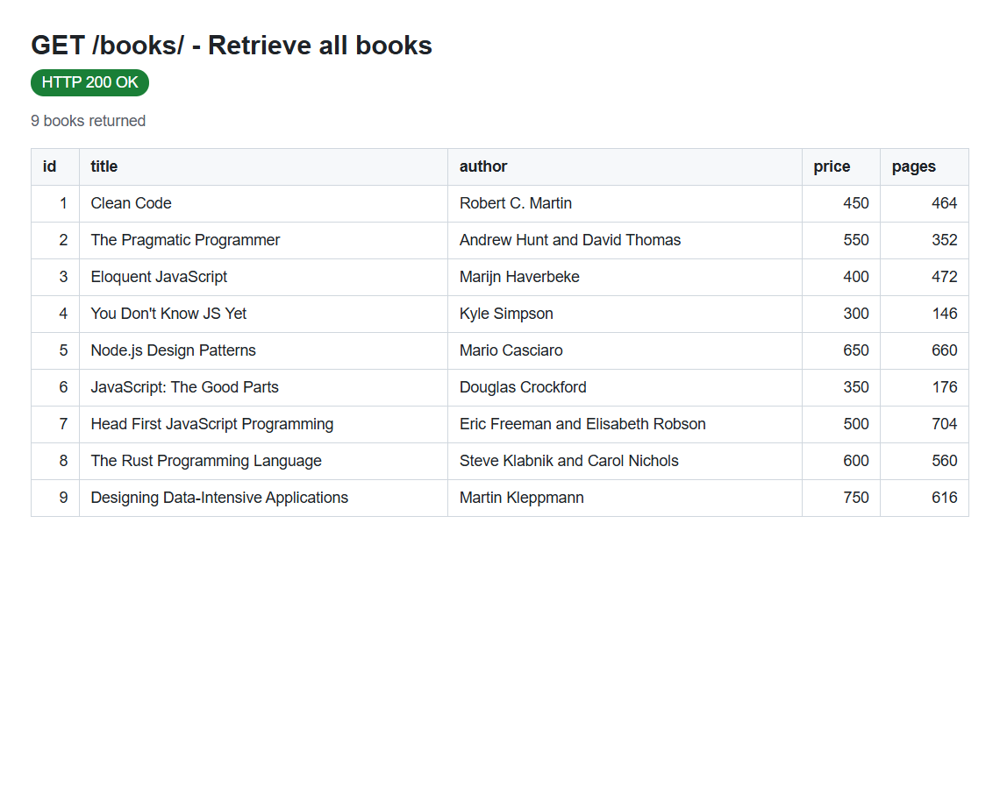
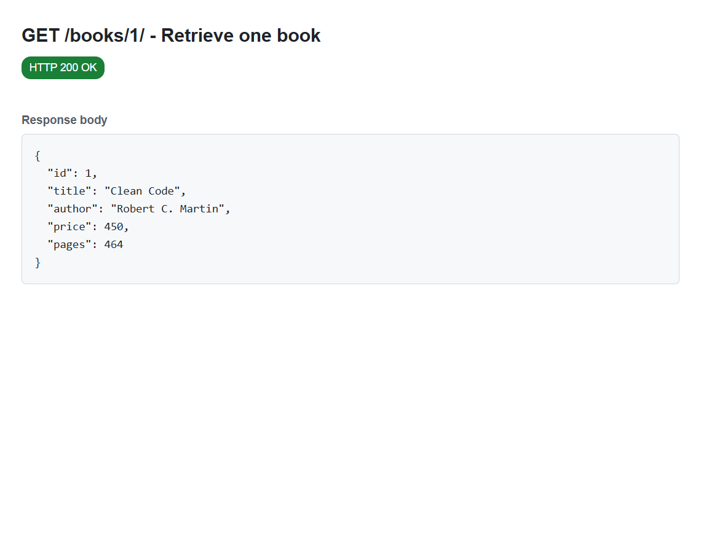
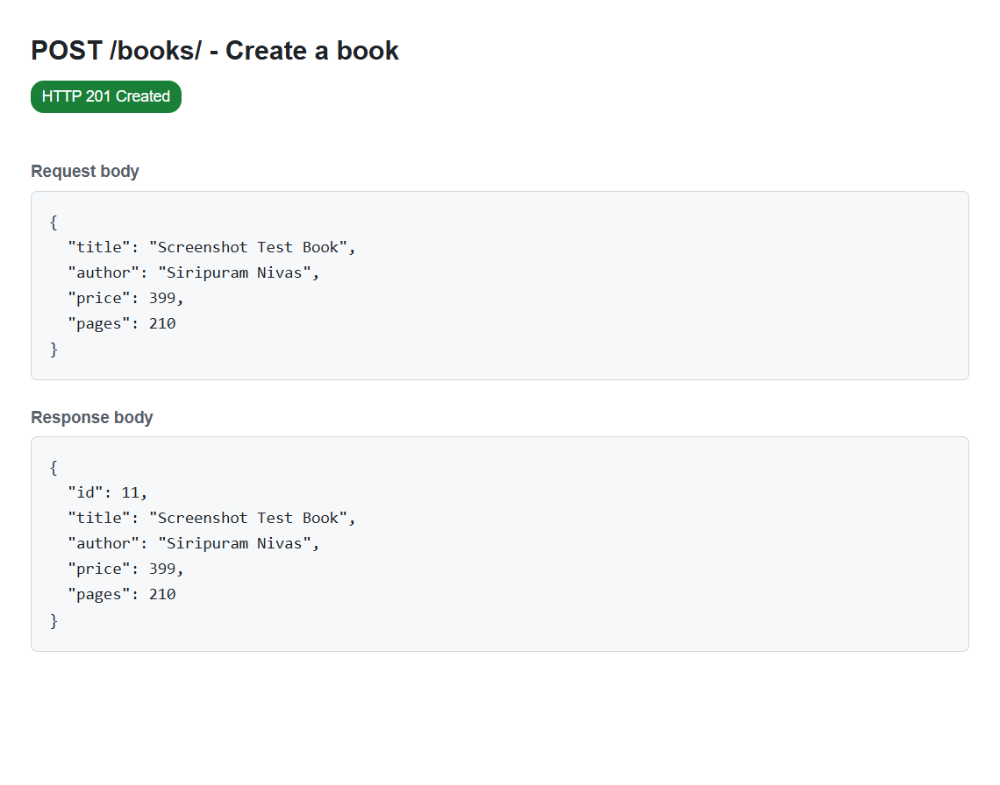
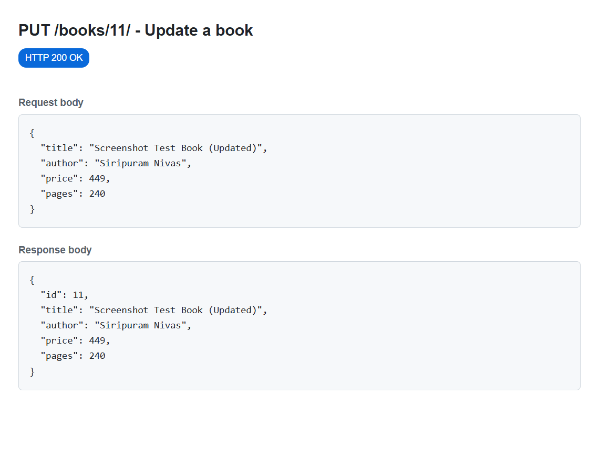
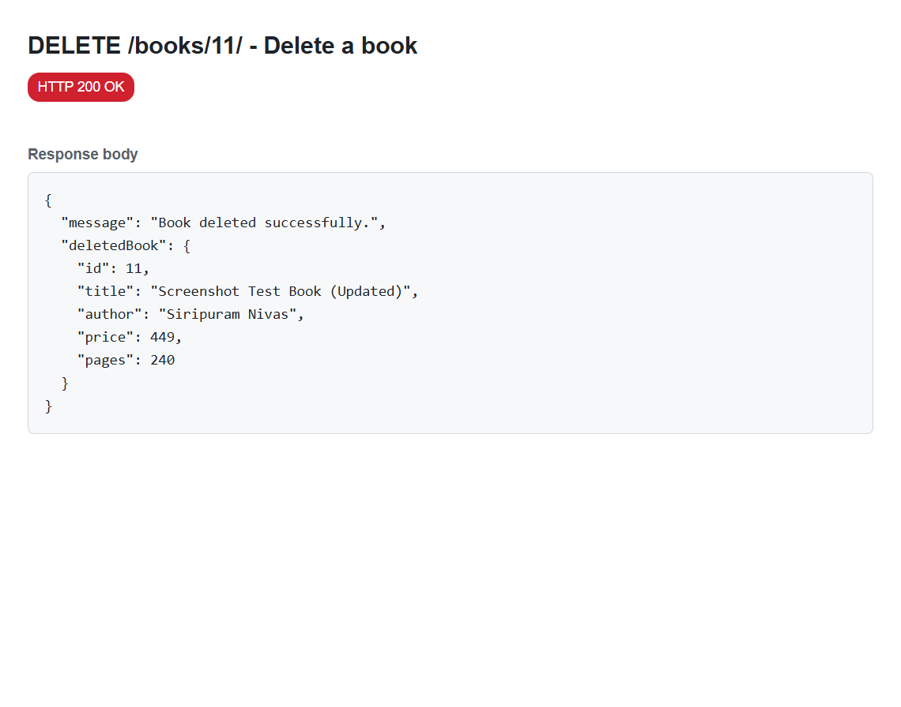
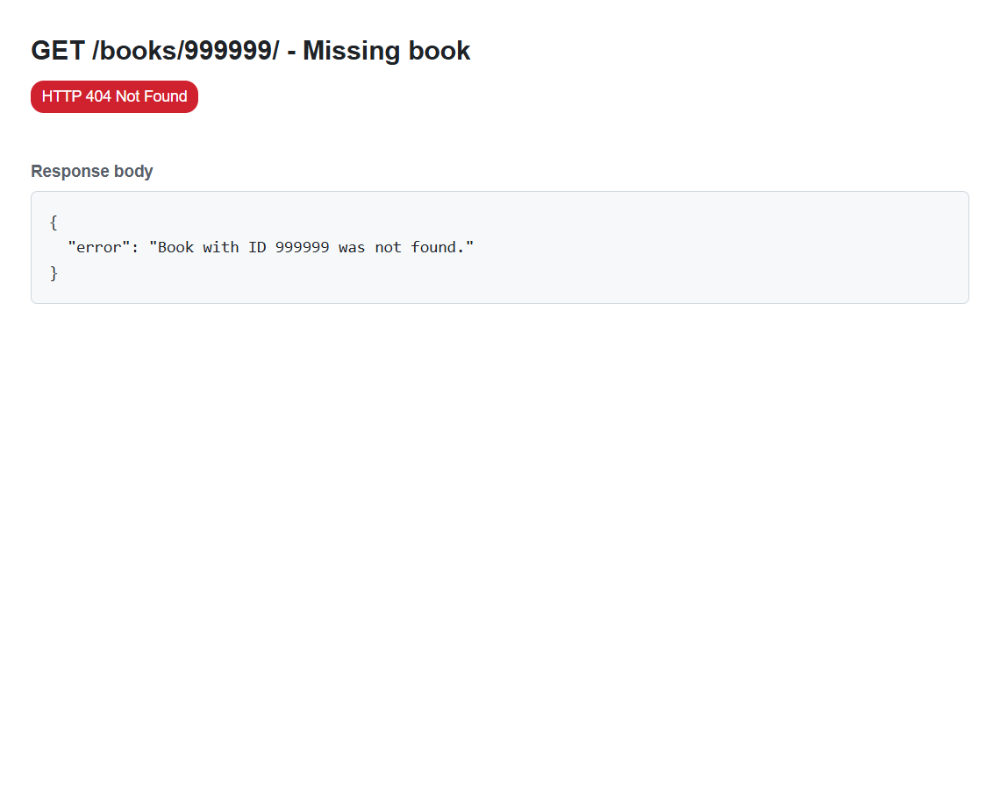
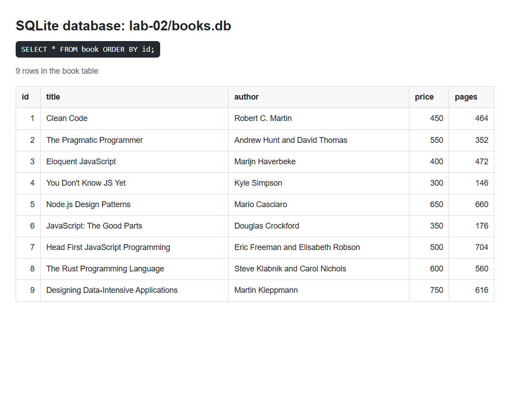

# Lab 2: SQLite Database and CRUD Routes

**Name:** Maduru Sampath Kumar Reddy  
**Registration number:** 252U1R7060  
**Section:** CSE(FSD)2B  
**Course:** Backend Development Fundamentals  
**Lab:** 02

**Live link:** Not applicable yet - this project has not been deployed. See
[Deployment notes](#deployment-notes) for the reason and the steps to deploy it.

---

## Objective

The objective of this lab is to connect an existing Express server to a SQLite
database and expose complete CRUD (Create, Read, Update, Delete) operations over
HTTP.

After completing this lab, the server can:

- create and initialise a SQLite database file named `books.db`;
- create the `book` table and insert sample data only once;
- return all books and a single book;
- add, update, and delete books through HTTP requests;
- validate request data and return suitable HTTP status codes;
- use parameterised SQL queries to prevent SQL injection.

---

## Technologies used

| Technology | Purpose |
| --- | --- |
| Node.js | JavaScript runtime |
| Express.js | Web framework for the HTTP routes |
| SQLite | Lightweight file-based relational database |
| `sqlite3` | Native SQLite driver for Node.js |
| `sqlite` | Promise-based wrapper that lets us use `async/await` |
| Nodemon | Restarts the server automatically while developing |
| Node.js test runner | Automated HTTP tests (`node --test`) |
| Postman | Manual API testing and screenshots |

---

## Project structure

```text
lab-02/
|-- server.js              # Database setup + Express routes
|-- books.db               # SQLite database file (created on first run)
|-- package.json           # Dependencies and npm scripts
|-- package-lock.json      # Exact dependency versions
|-- README.md              # This file
|-- tests/
|   `-- books.test.js      # Automated CRUD tests using node:test
`-- screenshots/
    |-- get-all-books.png
    |-- get-book-by-id.png
    |-- post-book.png
    |-- put-book.png
    |-- delete-book.png
    |-- error-404.png
    `-- database-rows.png
```

The repository also keeps the original Lab 1 project in the `lab-01/` folder.

---

## Installation

### Prerequisites

- Node.js 20.17 or newer (Node.js 24 was used during development)
- npm (installed with Node.js)
- Postman (optional, for manual testing)

### Install dependencies

```bash
cd lab-02
npm install
```

This installs `express`, `sqlite`, `sqlite3`, and the development dependency
`nodemon`.

### Environment variables

No `.env` file is required for normal use. The server supports these optional
variables:

| Variable | Default | Purpose |
| --- | --- | --- |
| `PORT` | `3000` | Port used by the Express server |
| `DB_PATH` | `./books.db` | Path of the SQLite database file |

Example (PowerShell):

```powershell
$env:PORT = "3001"
npm start
```

Do not commit a real `.env` file or any secret values.

---

## How to initialize and run the server

### Development mode (Nodemon)

```bash
npm run dev
```

Nodemon restarts the server whenever a project file changes.

### Normal mode

```bash
npm start
```

Expected terminal output on the first run:

```text
Inserted 9 sample books.
Server running at http://localhost:3000
SQLite database: C:\path\to\lab-02\books.db
```

On later runs the sample data is **not** inserted again:

```text
Database already contains 9 books. Skipping sample data.
Server running at http://localhost:3000
SQLite database: C:\path\to\lab-02\books.db
```

### Reset the database

Stop the server, delete `books.db`, and start the server again. The table and
the nine sample books will be recreated.

```powershell
Remove-Item books.db
npm start
```

### How the start-up works

`server.js` exports one asynchronous function, `initializeDBAndServer()`. It:

1. opens `books.db` using the `sqlite` package;
2. runs `CREATE TABLE IF NOT EXISTS book (...)`;
3. counts the rows and inserts nine sample books only when the table is empty;
4. calls `app.listen()` only after the database is ready;
5. prints the error and exits if initialisation fails.

This ordering is important: the server must not accept requests before the
database connection exists.

---

## Database schema

```sql
CREATE TABLE IF NOT EXISTS book (
    id INTEGER PRIMARY KEY AUTOINCREMENT,
    title TEXT NOT NULL,
    author TEXT NOT NULL,
    price INTEGER NOT NULL,
    pages INTEGER NOT NULL
);
```

### Sample rows

| id | title | author | price | pages |
| --- | --- | --- | --- | --- |
| 1 | Clean Code | Robert C. Martin | 450 | 464 |
| 2 | The Pragmatic Programmer | Andrew Hunt and David Thomas | 550 | 352 |
| 3 | Eloquent JavaScript | Marijn Haverbeke | 400 | 472 |
| 4 | You Don't Know JS Yet | Kyle Simpson | 300 | 146 |
| 5 | Node.js Design Patterns | Mario Casciaro | 650 | 660 |
| 6 | JavaScript: The Good Parts | Douglas Crockford | 350 | 176 |
| 7 | Head First JavaScript Programming | Eric Freeman and Elisabeth Robson | 500 | 704 |
| 8 | The Rust Programming Language | Steve Klabnik and Carol Nichols | 600 | 560 |
| 9 | Designing Data-Intensive Applications | Martin Kleppmann | 750 | 616 |

---

## Endpoints

| Method | Endpoint | Description | Success status |
| --- | --- | --- | --- |
| GET | `/books/` | Retrieve all books | 200 OK |
| GET | `/books/:bookId/` | Retrieve one book by ID | 200 OK |
| POST | `/books/` | Add a new book | 201 Created |
| PUT | `/books/:bookId/` | Update an existing book | 200 OK |
| DELETE | `/books/:bookId/` | Delete a book | 200 OK |

Error responses use these status codes:

| Status | When it is returned |
| --- | --- |
| 400 Bad Request | Invalid ID, missing/invalid fields, or malformed JSON |
| 404 Not Found | The book ID does not exist, or the route is unknown |
| 500 Internal Server Error | An unexpected database or server error |

---

## Sample requests and responses

All request bodies use JSON. Do not forget the `Content-Type: application/json`
header when testing manually.

### GET `/books/`

```bash
curl http://localhost:3000/books/
```

```json
[
  {
    "id": 1,
    "title": "Clean Code",
    "author": "Robert C. Martin",
    "price": 450,
    "pages": 464
  },
  {
    "id": 2,
    "title": "The Pragmatic Programmer",
    "author": "Andrew Hunt and David Thomas",
    "price": 550,
    "pages": 352
  }
]
```

The real response contains all nine seeded books.

### GET `/books/1/`

```bash
curl http://localhost:3000/books/1/
```

```json
{
  "id": 1,
  "title": "Clean Code",
  "author": "Robert C. Martin",
  "price": 450,
  "pages": 464
}
```

### GET `/books/999999/` (not found)

```json
{
  "error": "Book with ID 999999 was not found."
}
```

Status: `404 Not Found`

### GET `/books/not-a-number/` (invalid ID)

```json
{
  "error": "Invalid book ID. It must be a positive integer."
}
```

Status: `400 Bad Request`

### POST `/books/`

```bash
curl -X POST http://localhost:3000/books/ \
  -H "Content-Type: application/json" \
  -d '{"title":"Clean Code","author":"Robert C. Martin","price":450,"pages":464}'
```

```json
{
  "id": 10,
  "title": "Clean Code",
  "author": "Robert C. Martin",
  "price": 450,
  "pages": 464
}
```

Status: `201 Created`

If fields are missing or invalid:

```json
{
  "error": "Validation failed.",
  "details": [
    "author is required and must be a non-empty string.",
    "price is required and must be a positive integer.",
    "pages is required and must be a positive integer."
  ]
}
```

Status: `400 Bad Request`

Malformed JSON returns:

```json
{
  "error": "Invalid JSON in request body."
}
```

Status: `400 Bad Request`

### PUT `/books/10/`

```bash
curl -X PUT http://localhost:3000/books/10/ \
  -H "Content-Type: application/json" \
  -d '{"title":"Clean Code (2nd Edition)","author":"Robert C. Martin","price":500,"pages":480}'
```

```json
{
  "id": 10,
  "title": "Clean Code (2nd Edition)",
  "author": "Robert C. Martin",
  "price": 500,
  "pages": 480
}
```

Status: `200 OK`. A valid but nonexistent ID returns `404 Not Found`.

### DELETE `/books/10/`

```bash
curl -X DELETE http://localhost:3000/books/10/
```

```json
{
  "message": "Book deleted successfully.",
  "deletedBook": {
    "id": 10,
    "title": "Clean Code (2nd Edition)",
    "author": "Robert C. Martin",
    "price": 500,
    "pages": 480
  }
}
```

Status: `200 OK`. Deleting the same book again returns `404 Not Found`.

---

## Validation rules

| Field | Rule |
| --- | --- |
| `bookId` | Must be a positive integer (`1`, `2`, `3`, ...) |
| `title` | Required, non-empty string |
| `author` | Required, non-empty string |
| `price` | Required, positive integer |
| `pages` | Required, positive integer |

Leading and trailing spaces are removed from `title` and `author` before saving.

---

## Postman testing instructions

1. Start the server with `npm run dev` or `npm start`.
2. In Postman, create a collection called **Lab 2 - Books**.
3. Add a collection variable `baseUrl` with value `http://localhost:3000`.
4. Create the following requests:

| Request name | Method | URL |
| --- | --- | --- |
| Get all books | GET | `{{baseUrl}}/books/` |
| Get one book | GET | `{{baseUrl}}/books/1/` |
| Get missing book | GET | `{{baseUrl}}/books/999999/` |
| Add book | POST | `{{baseUrl}}/books/` |
| Update book | PUT | `{{baseUrl}}/books/10/` |
| Delete book | DELETE | `{{baseUrl}}/books/10/` |

5. For **Add book** and **Update book**, open the **Body** tab, choose
   **raw**, and select **JSON**. Example body:

```json
{
  "title": "Clean Code",
  "author": "Robert C. Martin",
  "price": 450,
  "pages": 464
}
```

6. Send each request and check the status code and JSON response.
7. To prove that the database changed, run the SQLite query shown below after
   each POST, PUT, or DELETE.

### Checking the database

If the SQLite command-line tool is installed:

```bash
sqlite3 books.db "SELECT id, title, author, price, pages FROM book ORDER BY id;"
```

If the CLI is not installed, use this Node.js command from the `lab-02` folder:

```bash
node -e "const sqlite3=require('sqlite3');const{open}=require('sqlite');(async()=>{const db=await open({filename:'books.db',driver:sqlite3.Database});console.table(await db.all('SELECT * FROM book ORDER BY id'));await db.close();})()"
```

### Optional Postman test scripts

In the **Tests** tab of a request, you can add checks such as:

```javascript
pm.test("status code is 200", function () {
  pm.response.to.have.status(200);
});

pm.test("response is a JSON array", function () {
  pm.expect(pm.response.json()).to.be.an("array");
});
```

For POST, check for `201`. For missing books, check for `404`.

---

## Screenshots

The screenshots below were captured from actual requests against the running
server. If your faculty specifically requires Postman-branded screenshots,
replace these files with your own Postman screenshots using the same names.

### GET `/books/` - all books



### GET `/books/1/` - one book



### POST `/books/` - create a book



### PUT `/books/10/` - update a book



### DELETE `/books/10/` - delete a book



### GET a missing book - 404 response



### Database rows after the requests



---

## Automated tests

The project uses Node.js's built-in test runner, so no extra testing library is
needed. The tests start the real server with a temporary database, call every
endpoint with `fetch`, and delete the temporary database afterwards.

```bash
npm test
```

Test results (actually executed):

```text
▶ Lab 2 - Books CRUD API
  ✔ GET /books/ returns all seeded books
  ✔ GET /books/:bookId/ returns one book
  ✔ GET /books/:bookId/ returns 404 for a missing book
  ✔ GET /books/:bookId/ returns 400 for an invalid ID
  ✔ POST /books/ creates a book and returns 201
  ✔ POST /books/ rejects a body with missing fields
  ✔ POST /books/ rejects invalid JSON
  ✔ PUT /books/:bookId/ updates an existing book
  ✔ PUT /books/:bookId/ returns 404 for a missing book
  ✔ DELETE /books/:bookId/ deletes an existing book
  ✔ DELETE /books/:bookId/ returns 404 for a missing book
  ✔ changes persist in SQLite after a server restart
✔ Lab 2 - Books CRUD API
ℹ tests 12
ℹ pass 12
ℹ fail 0
```

### Manual verification results

These requests were also executed against the real `books.db`:

| Check | Result |
| --- | --- |
| GET all books | `200`, 9 books |
| GET book 1 | `200`, Clean Code |
| GET missing book | `404` |
| POST a valid book | `201`, created id 10 |
| POST with missing fields | `400` with details |
| POST with malformed JSON | `400` |
| PUT book 10 | `200`, updated title/price/pages |
| PUT missing book | `404` |
| DELETE book 10 | `200`, deleted book returned |
| GET deleted book | `404` |
| Database file after mutations | Book 10 was inserted, updated, and removed; 9 seed rows remained |

---

## Problems faced and solutions

| Problem | Solution |
| --- | --- |
| The first `npm install` was interrupted and npm removed packages that were not saved in `package.json`. | Installed `express`, `sqlite`, and `sqlite3` together, then installed `nodemon` with `--save-dev`, so all packages were recorded correctly. |
| Port `3000` was already used by the Lab 1 server. | Run only one lab at a time with `Ctrl+C`, or start Lab 2 with `$env:PORT = "3001"; npm start`. |
| Sample books were duplicated when the server restarted. | The server counts rows first and inserts sample data only when the table is empty. |
| `express.json()` rejected malformed JSON with an HTML error page. | Added an Express error-handling middleware that returns `400` with a JSON message. |
| SQLite CLI was not installed on the computer. | Used the `sqlite` Node.js package to inspect the database, and documented the CLI query for machines that have it. |
| `sqlite3` is a native module and can take time to install on Windows. | Allowed the install to finish and verified it with `node -e "require('sqlite3')"`. |
| Tests would have modified the real database. | The server accepts a `DB_PATH` environment variable, so tests use `tests/test-books.db` and delete it afterwards. |

---

## Deployment notes

**Live link: Not applicable.**

The project was not deployed because no hosting account or permission to deploy
was provided, and this lab submission can be verified locally with the
automated tests and screenshots.

If you deploy later, Render or Railway can run the Express server:

- Build command: `npm install`
- Start command: `npm start`
- Set `PORT` from the hosting provider's environment (the code already reads it).

**SQLite persistence limitation:** most free hosting plans use an ephemeral
filesystem. The `books.db` file can be deleted or reset when the service
restarts or redeploys, so POST/PUT/DELETE changes may disappear. To keep data,
attach a persistent disk (for example at `/data`) and set
`DB_PATH=/data/books.db`. If persistent storage is not available, say in the
README that the database resets on redeploy, or use a hosted database instead.

After deploying, replace the line above with the public URL.

---

## Viva preparation

### 1. Why do we use `await` for database operations?

Database work happens outside the main JavaScript thread. `await` pauses the
current async function until the query finishes and gives us the result. This
keeps the code readable and prevents us from using a result before it is ready.
It also lets other requests be handled while the database is working, instead of
blocking the whole server.

### 2. What is SQL injection?

SQL injection is an attack where a user puts SQL code into an input field so
that it becomes part of the query. For example, if the server builds a query by
joining strings, an input like `' OR 1=1 --` could change the query's meaning and
expose or destroy data.

### 3. How do `?` placeholders prevent SQL injection?

With placeholders, the SQL statement and the values are sent separately:

```js
await db.run(
  "INSERT INTO book (title, author, price, pages) VALUES (?, ?, ?, ?)",
  [title, author, price, pages]
);
```

SQLite treats each value as data, never as SQL code, so quotes or keywords
inside the value cannot change the query.

### 4. When is PUT used instead of POST?

- **POST** creates a new resource and usually returns `201 Created`.
- **PUT** updates or replaces an existing resource and usually returns `200 OK`.

In this lab, `POST /books/` adds a book with a new ID, while
`PUT /books/:bookId/` changes the book that already has that ID.

### 5. What is CRUD?

CRUD stands for **Create, Read, Update, Delete** - the four basic operations on
stored data.

| CRUD operation | HTTP method | This lab |
| --- | --- | --- |
| Create | POST | Add a book |
| Read | GET | Get all books / one book |
| Update | PUT | Change a book |
| Delete | DELETE | Remove a book |

### 6. What is SQLite?

SQLite is a small, file-based relational database. It does not need a separate
database server; the whole database is stored in a single file (`books.db`).
It is easy to set up and is useful for learning, small applications, and
embedded systems.

### 7. What is the purpose of `initializeDBAndServer()`?

It opens the SQLite database, creates the `book` table if needed, inserts sample
data only when the table is empty, and starts the Express server only after the
database is ready. If any database step fails, it logs the error and stops the
process instead of running a server with a broken database connection.

### 8. What is the difference between 200, 201, 400, and 404?

| Code | Meaning | Example in this lab |
| --- | --- | --- |
| 200 OK | The request succeeded | GET, PUT, DELETE succeeded |
| 201 Created | A new resource was created | POST added a book |
| 400 Bad Request | The client sent invalid data | Missing fields, bad ID, bad JSON |
| 404 Not Found | The requested resource does not exist | Book ID not found, unknown route |

---

## Suggested Git commits

Do not push until you are ready to submit. Meaningful commits could be:

```bash
git add lab-01 lab-02 .gitignore README.md
git commit -m "chore: preserve lab-01 and add lab-02 folder structure"

git add lab-02/package.json lab-02/package-lock.json lab-02/server.js
git commit -m "feat(lab-02): connect Express server to SQLite and add CRUD routes"

git add lab-02/tests lab-02/books.db
git commit -m "test(lab-02): add automated CRUD and persistence tests"

git add lab-02/README.md lab-02/screenshots
git commit -m "docs(lab-02): document endpoints, test results, and viva answers"
```

---

## Manual actions still needed

1. Fill in your **registration number** and **section** at the top of this file.
2. If your faculty requires Postman screenshots, replace the files in
   `screenshots/` with your own Postman screenshots (keep the same names).
3. Deploy the server if a live link is required, then add the URL at the top.
4. Push the repository to GitHub after checking the changes.
